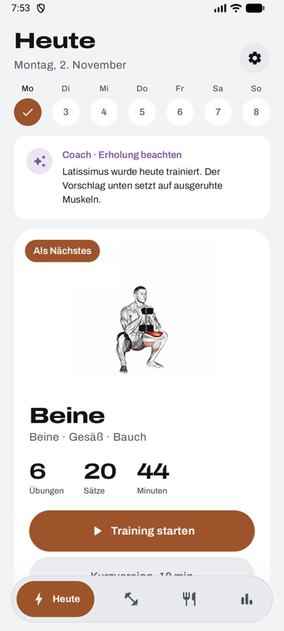
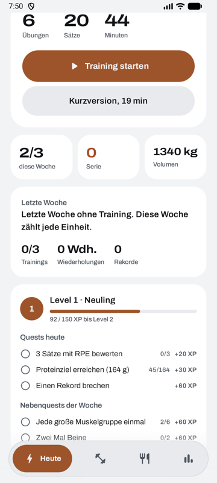
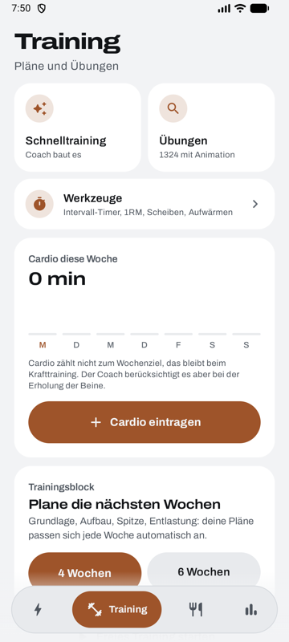
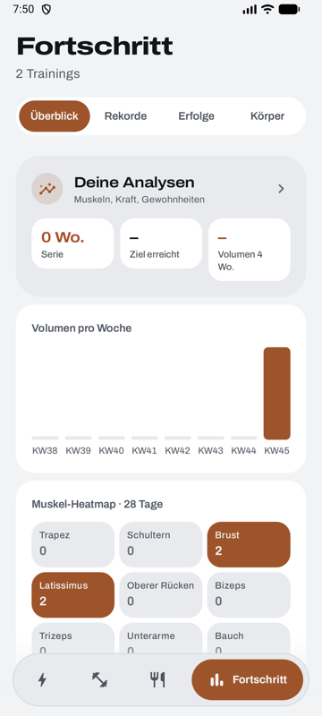
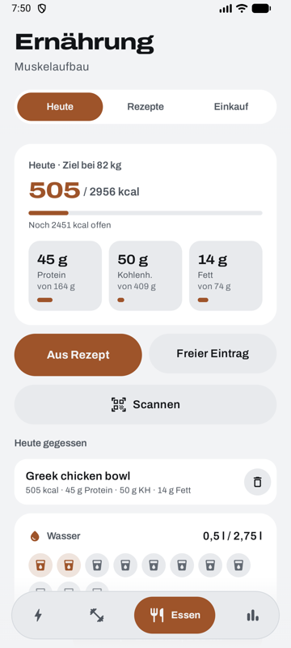
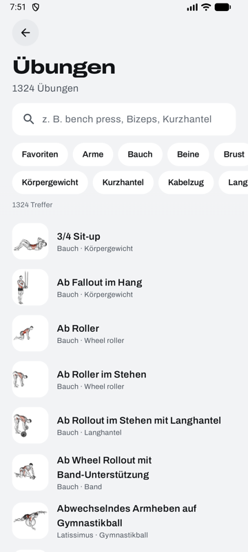

<div align="center">

# Mauve Fit

**A strength training coach for Android and Wear OS that plans, tracks and adapts your workouts, without an account.**

[](https://github.com/mauricekleindienst/MauveFit/releases/latest)


[Download](#install) · [Features](#features) · [Build](#build-from-source) · [Release process](#releases-and-updates) · [Roadmap](ROADMAP.md)

   

</div>

---

## Why Mauve Fit

Most training apps are either a blank logbook or a subscription. Mauve Fit sits in between: it builds a plan from a few questions, suggests the weight for every set, notices plateaus and recovery, and keeps everything on your phone. No account, no tracking, no ads.

## Features

### Training
- **Plans from a short intro**: goal, experience, training days, equipment, focus areas and joint limits. The coach picks the exercises and sets.
- **Smart weights**: progression from your last session, first-time estimates from body weight and level, rep progression for body-weight work, an automatic 80 % comeback after a break.
- **Workout screen**: one page per exercise with steppers, set types and RPE, voice input ("sechzig mal acht"), swap, warm-up ramp, plate calculator, supersets, notes and a German or English how-to for all 1,324 exercises.
- **Rest timer** that survives a locked phone: live notification with countdown, last set and next set, an alert at the end, on Android 16 as a live update.
- **Training blocks and light weeks**: base, build, peak and deload phases adjust the plan week by week.
- **Edit afterwards**: correct a weight, reps or remove a set in a finished workout.

### Motivation, built for the long run
- **XP and levels** with no cap: every workout, set, record, challenge and quest pays XP. Titles from Rookie to Legend.
- **Daily quests**: three new ones each day from twelve kinds (train, sets, records, water, protein, RPE, a new exercise, cardio, weigh-in, warm-ups, supersets, rating), plus a quest streak that pays more every day.
- **Weekly challenge plus two side quests**, week streaks with freezes.
- **Coins and a shop**: coins for training, records, quests, achievements, skill levels and collection tiers. Spend them on streak freezes, quest rerolls, XP boosters, premium accent colours and 16 titles, each with its own drawn icon and rarity (Common to Mythic). The better items unlock at higher levels, up to level 75.
- **Skills**: every muscle group levels up with its working sets.
- **Collections**: every exercise fills a collection from tier I to X (10 to 2,000 sets).
- **About 75 achievements** in Bronze, Silver, Gold, Platinum and Diamond, from the first workout to 1,000 workouts, 10,000 tons, two-year streaks and 365 days of quests.

### Progress
- Records, estimated 1RM charts, weekly volume, muscle heatmap, monthly recap and a weekly report every Monday.
- Insights: consistency, strength trends, plateaus, training times, effort and how sleep relates to performance.
- Body weight with goal and pace, measurements, progress photos (kept on the phone only).

### Nutrition
- Calorie, protein, carb and fat targets from body weight and goal.
- Recipes with portions, a weekly meal plan and shopping list, barcode scanning (Open Food Facts), water tracking.

### Wear OS and widgets
- **Watch app and tile**: current exercise, set, weight and reps, tick off sets, adjust weight, rest countdown with vibration, heart rate.
- **Home screen widgets**: next or running workout with a live rest clock and "Done" button, nutrition with "+ glass", streak with the last eight weeks.

### Platform
- **Health Connect**: reads sleep, heart rate and HRV for a readiness score, imports cardio, writes workouts and body weight back.
- **In-app updates** from GitHub releases (see below).
- Light and dark theme, six accent colours, German and English, large-text and TalkBack checked.
- Backup and restore as a JSON file, CSV export for spreadsheets.

<details>
<summary>More screenshots</summary>

 

</details>

## Install

1. Open the [latest release](https://github.com/mauricekleindienst/MauveFit/releases/latest).
2. Download `MauveFit-<version>.apk` on your phone and open it. Android asks once to allow installs from your browser.
3. Optional, for the watch: install `MauveFit-Watch-<version>.apk` on a Galaxy Watch or other Wear OS watch:
   ```bash
   adb connect <watch-ip>:<port>
   adb install MauveFit-Watch-<version>.apk
   ```
   (Enable developer options and wireless debugging on the watch first.) Phone and watch app must come from the same release.

From then on the app checks for new releases itself and installs them with one tap: **Settings > App update**, or the card that appears on the Today screen.

## Build from source

Requirements: Android Studio (its bundled JDK 17+), Android SDK 37.

```bash
git clone https://github.com/mauricekleindienst/MauveFit.git
cd MauveFit
./gradlew :app:assembleRelease :wear:assembleRelease
./gradlew :app:testDebugUnitTest
```

APKs land in `app/build/outputs/apk/release/` and `wear/build/outputs/apk/release/`. Release builds are minified with R8.

> Updates only install over an existing app when both are signed with the same key. Builds from another machine use another debug key, so uninstall the old app first (export a backup in Settings > Data before).

## Releases and updates

Releases are published with one script:

```bash
# 1. raise versionCode and versionName in app/ and wear/build.gradle.kts
# 2. add a "## Erledigt in <version>" section to ROADMAP.md (it becomes the release notes)
scripts/release.sh            # tests, builds, pushes main, creates tag v<version> with both APKs
scripts/release.sh --dry-run  # builds and shows what would be published
```

The app asks `api.github.com/repos/mauricekleindienst/MauveFit/releases/latest` at most twice a day, compares the tag with the installed version, downloads the phone APK and hands it to the Android installer. Nothing else is sent anywhere.

## Project layout

```
app/src/main/java/dev/mauve/fit/
  data/      models, store (JSON on device), coach, stats, insights, quests, nutrition
  ui/        Compose screens: today, workout, plans, progress, nutrition, settings, intro
  system/    workout service and notifications, Health Connect, updater, media cache
  widget/    Glance home screen widgets
  watch/     phone side of the watch sync
wear/        Wear OS app and tile
scripts/     release script
```

Tests: `app/src/test` (JUnit, 122 tests for coach logic, statistics, quests, parsing and more).

## Privacy

All data stays on the phone in the app's private storage. There are no accounts, analytics or ads. Exercise pictures (muscle maps and drawings) are bundled with the app. Network access is used for barcode lookups (Open Food Facts) and the update check against GitHub. Health Connect access is optional and asked for per data type.

## Credits and licences

- Exercise data: [hasaneyldrm/exercises-dataset](https://github.com/hasaneyldrm/exercises-dataset), MIT licence, © 2026 Hasan Emir Yıldırım. German translations of names and instructions are this project's own.
- Muscle map shapes: react-native-body-highlighter, © 2022 ELABBASSI Hicham (MIT).
- Exercise drawings: Everkinetic (https://github.com/everkinetic/data), CC BY-SA 4.0, scaled down and reduced to four grey levels.
- Both live in `ios/MauveFit/Resources/` and are shared by the Android and iOS apps.
- Font: Archivo, SIL Open Font License.

---

<sub>Mauve Fit wird in Deutschland entwickelt; die App ist vollständig auf Deutsch und Englisch.</sub>
